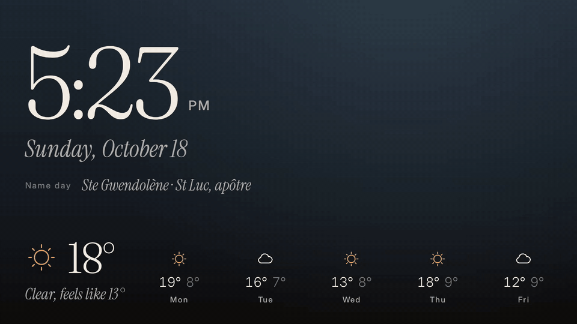
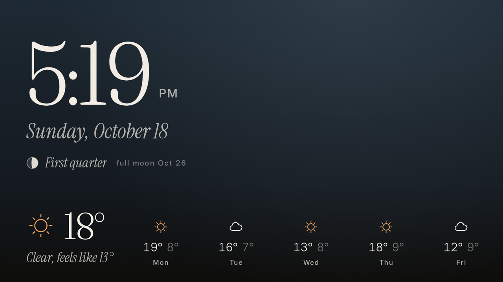
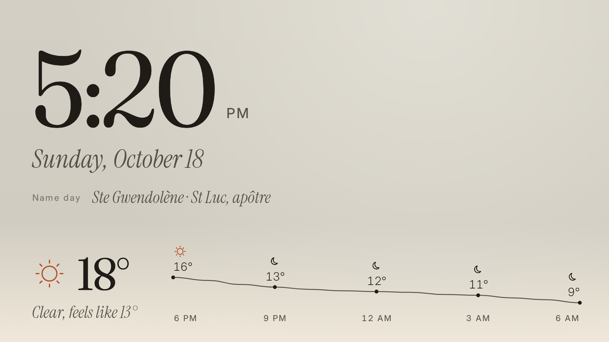
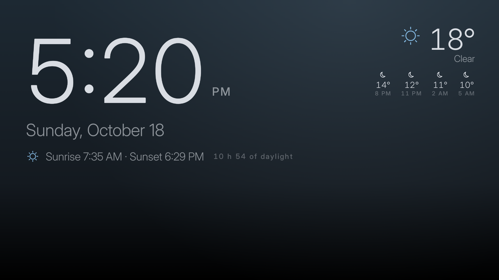
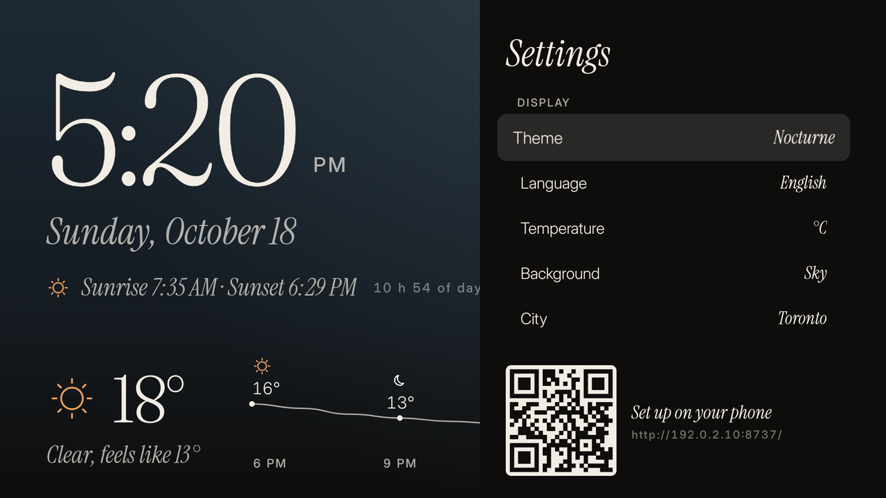
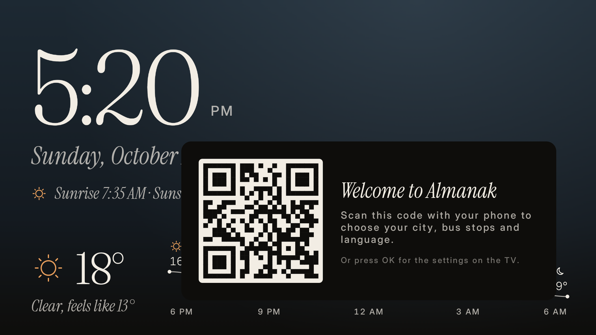

# Almanak

[](https://github.com/algotitanhq/almanak/actions/workflows/ci.yml)
[](LICENSE)

**An ambient almanac for Android TV and Google TV, made to be left on**: the time, the date, the weather, the next
bus in real time, the sun and the moon, a fact of the day, a generative sky that follows the hour, and a
screensaver. Kotlin, Compose for TV, open data, no account, no ads.

<p align="center">
  
</p>

<sub>Android TV emulator, 1080p, Toronto. The setup QR code on the images is a placeholder that leads nowhere
(`http://192.0.2.10:8737/`, a documentation address).</sub>

## What it shows

| | |
|---|---|
| **Clock** | Large time and date, readable across the room, in the UI language and the TV's region (12 h or 24 h). |
| **Weather** | [Open-Meteo](https://open-meteo.com) (no key): now, feels-like, the next hours as a curve or the next five days; "as of" when the network is down. °C or °F. |
| **Next bus** | Real-time departures (GTFS-realtime) for up to 6 stops, one block per route and direction; timetable times, shown muted, when there is no realtime feed. Presets for a few networks, or any GTFS feed. |
| **Almanac** | Sunrise, sunset and day length, the moon's phase and the next full moon (computed on the TV), name days, day and week of the year, and "on this day" from Wikimedia. |
| **Backgrounds** | A generative sky that follows the real sun (night, dawn, day, dusk), the Wikimedia picture of the day, or your own image URL, with a scrim that keeps text readable. |
| **Themes** | *Nocturne* (serif, dark), *Minimal* (sans, dark), *Paper* (serif, light). Burn-in protection drifts the foreground a few pixels every 3 minutes. |
| **Screensaver** | The same screen as a Daydream (`DreamService`): the TV shows it after its idle delay. |
| **Phone setup** | A QR code opens a page served by the TV on your network: city search, network, stops, line filter, wallpaper URL, guest Wi-Fi, realtime key. |
| **Guest Wi-Fi** | Press an arrow on the remote: a join QR code for your guest network for 60 seconds. |

The UI comes in English, French and Spanish. A fresh install has no city, network or stop: weather, sun, moon and
sky start from the TV's time zone (the city it is named after, shown as "Paris · time zone") until a city is set.

## Screenshots

| | |
|---|---|
|  |  |
| *Nocturne*, Toronto, with the moon and the five-day forecast. | *Paper*, the light theme, with the hourly curve and the name day. |
|  |  |
| *Minimal*, with the weather moved to the right and the sun times under the clock. | The TV settings drawer (OK on the remote), with the phone setup QR code. |
|  | |
| First launch, before any setup: the time zone already gives weather and sun times. | |

All images come from the Android TV emulator (1080p) on a debug build, with the debug launch extras listed below.

## Getting started

### Requirements

- JDK 17+ (tested with Temurin 21).
- Android SDK with `platforms;android-37.2` and `build-tools;36.0.0`:
  ```sh
  sdkmanager "platforms;android-37.2" "build-tools;36.0.0" "platform-tools"
  ```
- Nothing else: the Gradle wrapper downloads Gradle 9.7.1. No key is needed to build or run.

### Build

```sh
git clone https://github.com/algotitanhq/almanak.git && cd almanak
echo "sdk.dir=$HOME/Android/Sdk" > local.properties    # your SDK path; local.properties is gitignored
./gradlew assembleDebug testDebugUnitTest
```

`./gradlew assembleRelease` gives an R8-minified APK (about 4 MB): sign it with your own key (`apksigner`) before
installing. The repository ships no signing key.

### Sideload on the TV

On the TV: Settings → Device Preferences → About → press *Build* seven times, then Developer options →
**Network debugging** (or USB debugging). Then, from the computer:

```sh
adb connect <tv-ip>:5555          # accept the prompt on the TV the first time
./gradlew installDebug
adb shell am start -n app.almanak/.MainActivity
```

Almanak appears in the TV's app row (Leanback launcher).

## Configuration

### On the TV and on the phone

On the TV, press **OK** (or Menu) on the remote to open the settings drawer. Every row changes with OK, the screen
updates live, and BACK closes it: theme, language, °C/°F, background, city (the cities nearest the TV's time zone),
and each module's on/off, position and size.

For everything that needs typing, scan the **QR code** in the drawer (or on the first-launch card) with your phone.
The page, in the TV's language, lets you search a city, pick the transit network, add, remove or reorder up to 6
stops (by code or street name), set a line filter, set a wallpaper URL, set up the guest Wi-Fi and paste a realtime
key. It only works while the drawer is open, only with the code in the QR, and only from the same network as the
TV. The realtime key and the Wi-Fi password never go back to the page: leave the field empty to keep them.

Settings live in the app's private storage (`files/settings.json`). Clearing the app's data resets them.

### Transit networks

Presets (`settings/Transit.kt`): STM (Montréal, realtime with a key), RTC (Québec), OC Transpo (Ottawa, realtime
with a key), TTC (Toronto, realtime) and STS (Sherbrooke, realtime). Each lists the agency's GTFS URL and its
[Mobility Database](https://mobilitydatabase.org) mirror, tried in order. **Other** takes any GTFS zip URL, plus an
optional GTFS-realtime TripUpdates URL and key (sent as a header or a URL parameter): most networks in the world
publish one.

Changing the network clears the stops; the new schedule downloads in the background (tens of MB for a large city)
before stops can be searched. Until then the bus block says "Fetching the bus schedule…". One block per route and
direction at each stop; up to 3 blocks use the large layout, from 4 on each becomes one line. A line with nothing in
the next 2 hours shows its next timetable departure ("tomorrow 6:47"). Trips that end at a stop are not shown there.

### Realtime key (optional)

Without a key, bus times are the published schedule (shown muted, with "scheduled times"). Networks whose feed
needs a key link their developer portal from the phone page; paste the key there at any time. To bake one into a
build instead, add it to `local.properties` (or export `REALTIME_API_KEY` and `REALTIME_KEY_AGENCY`):

```properties
# A GTFS-realtime key for one network only (its id in settings/Transit.kt). One per line: no trailing comments.
realtime.apiKey=YOUR_KEY
realtime.keyAgency=octranspo
```

A build-time key is only ever sent to the network named in `realtime.keyAgency`. The older `stm.apiKey` /
`STM_API_KEY` still works and means an STM key.

### VPN and realtime feeds

Some agencies' servers reject VPN or data-centre IP addresses. Almanak then falls back to the Mobility Database
mirror for the static schedule, but a realtime feed usually exists only at the agency. If the TV runs a VPN and the
bus times stay on "scheduled times", exclude Almanak from the VPN (split tunnelling in most VPN apps), or accept
timetable times.

### Screensaver (Daydream)

**Android TV (e.g. NVIDIA Shield):** Settings → Device Preferences → Screen saver → Screen saver → **Almanak**.
"When to start" sets the delay; "Start now" previews it.

**Google TV (Chromecast with Google TV, Google TV sets):** the Settings UI only offers Ambient mode, so set it
with adb:

```sh
adb shell settings put secure screensaver_components app.almanak/.AlmanakDream
adb shell settings put secure screensaver_enabled 1
adb shell settings put system screen_off_timeout 900000      # start after 15 min of inactivity (ms)
adb shell am start -n com.android.systemui/.Somnambulator    # start it now, to check
```

To go back to the stock screensaver:

```sh
adb shell settings put secure screensaver_components com.google.android.apps.tv.dreamx/.service.Backdrop   # Google TV Ambient mode
adb shell settings put secure screensaver_components com.google.android.backdrop/.Backdrop                 # Android TV Backdrop
```

Any remote key wakes the TV. While the screensaver is not showing, nothing refreshes.

### Debug launch extras

For captures and tests, debug builds read these `am start` extras:

| Extra | Effect |
|---|---|
| `--es locale fr-CA` | UI language and region |
| `--ez offline true` | weather behaves as if the network were down (cached value + "as of") |
| `--ez fakeRt true` | the next bus at each stop is marked realtime, 2 min late |
| `--es variant glyphs` | sheet of all weather icons |
| `--es variant fact-moon` | pin the almanac line to one fact (`sun`, `moon`, `calendar`, `saint`, `history`) |
| `--es theme minimal` | `nocturne` (default), `minimal`, `paper` |
| `--es wallpaper potd` | `none`, `sky` (default), `potd` (Wikimedia picture of the day), `url` (+ `--es wallpaperUrl https://…`) |
| `--es scrim veil` | compare scrim styles (`local` is the default) |
| `--es sky dusk` | force the sky phase (`night`, `dawn`, `day`, `dusk`) |
| `--es modules almanac` | show only these modules (`weather,bus,almanac`) |
| `--ez settings true` | start with the settings drawer open |
| `--ez wifi true` | start with the guest Wi-Fi card shown (if a network is set) |
| `--es setupUrl http://192.0.2.10:8737/` | show this address and its QR code instead of the setup page's real one (README captures) |

`tools/shot.sh <name> [extras…]` installs, launches, captures `shots/<name>.png` and prints suspicious log lines
(both need `ALMANAK_DEVICE=ip:port`, the adb address of the TV; there is no default).
`tools/soak.sh [hours] [every_min]` starts the screensaver and logs memory. `tools/readme_media.sh` scales a
capture and turns a screen recording into the README GIF. `shots/` is gitignored: local captures only.

## Architecture

Single module, manual dependency wiring, no DI framework:

```
app/src/main/java/app/almanak/
  MainActivity.kt      entry point (Leanback launcher)
  AlmanakDream.kt      screensaver (DreamService) hosting the same UI
  AlmanakApp.kt        Application + AppGraph (manual wiring)
  AmbientViewModel.kt  clock, weather, bus state; refresh loops run only while visible
  clock/               minute ticker, date and time formatting
  weather/             Open-Meteo client and on-disk cache
  transit/             GTFS extraction, WorkManager sync, GTFS-realtime client, departure merging
  ephemeris/           sun and moon (computed locally), saints, Wikimedia "on this day"
  wallpaper/           generative skies, picture of the day and custom URL photos, luminance for the scrim
  settings/            settings model and DataStore, transit presets, time zone places
  web/                 phone setup: a tiny token-protected HTTP server and its API (page in res/raw/setup.html)
  ui/                  composables (clock, weather, bus, glyphs, backdrop, settings drawer), themes
tools/                 device verification, soak test, README media, saints builders, brand asset renderer
```

A few structural choices, detailed in [`DECISIONS.md`](DECISIONS.md):

- **Static schedule on the TV.** The GTFS zip is downloaded and reduced to the chosen stops in the background
  (WorkManager), so departures keep working offline; realtime only adjusts them.
- **Nothing runs unseen.** Refresh loops follow the activity's or the dream's lifecycle.
- **No account, no cloud.** Settings stay on the TV; the phone talks to the TV directly, with a one-time code.
- **Neutral first run.** No default city, network or language: the TV's time zone and region decide until you do.

## Project status

Built in vertical slices, each one run and checked on an NVIDIA Shield (Android TV 11, API 30):

- ✅ **1–7**: clock, weather, realtime bus, ephemeris, wallpapers and themes, screensaver, personalisation with the
  phone setup page.
- ✅ **Neutral defaults**: no city or network until you choose; time zone place, regional locale.
- ✅ **CI**: build and unit tests on every push and pull request.
- 🔜 Signed releases built by CI, and a soak test of 24 hours on the device.

State, measures and open debts: [REPORT.md](REPORT.md).

**Known limitations.** Tested on Android TV (Shield, emulator); Google TV is documented but not yet run on a device.
Long route names (e.g. TTC headsigns) are cut on the compact bus layout.

## Licence and credits

Almanak's code is released under the [MIT licence](LICENSE). Data and assets:

- Weather: [Open-Meteo](https://open-meteo.com) (CC BY 4.0).
- Transit: each network's GTFS and GTFS-realtime under its own open-data licence (STM: CC BY 4.0), via the agency
  or the [Mobility Database](https://mobilitydatabase.org) mirror.
- Wikimedia "On this day" and the picture of the day (CC BY-SA 4.0 and each image's licence).
- Bundled: French name days from data.gouv.fr (Licence Ouverte 2.0), the Spanish *santoral* from Wikipedia
  (CC BY-SA 4.0), the IANA tz database `zone.tab` (public domain). Details in
  [`third_party/DATA.md`](third_party/DATA.md).
- Fonts: Fraunces, Inter and Instrument Serif, under the SIL Open Font License ([`third_party/fonts/`](third_party/fonts/)).

The TV's **Sources** screen (end of the settings drawer) lists each block's source and licence.
